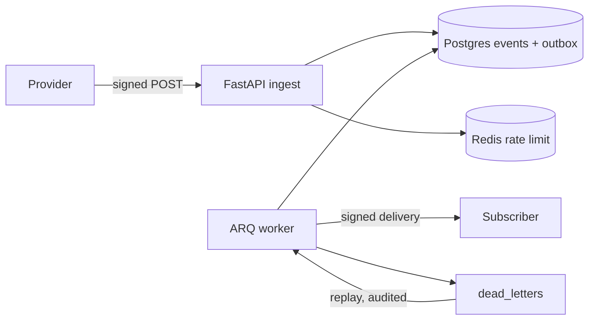

# HookRelay

> A webhook gateway that accepts anything, loses nothing, duplicates nothing, and can
> replay a bad day of events without double-charging a customer.

**Status:** in development — Phase 0 (bootstrap).

**Stack:** Python 3.12 · FastAPI · Pydantic v2 · SQLAlchemy 2.0 · PostgreSQL 16 · Redis 7 ·
ARQ · Docker · GitHub Actions

## The problem

Providers retry. Networks fail. Subscribers go down for an hour. Most webhook endpoints
store a row and hope for the best, so a retry storm double-charges a customer and a
subscriber outage silently drops events.

## What it does

- Verifies HMAC signatures with a replay window and a request size cap.
- Dedupes on `(source, idempotency_key)` so retries create exactly one event.
- Fans out through a transactional outbox with exponential backoff and jitter.
- Classifies failures: 4xx is permanent, 5xx/429/network is retried.
- Dead-letters exhausted deliveries and replays them with an audit trail.
- Exposes traces, Prometheus metrics, and structured logs with request IDs.

## Architecture



## Run it

Not yet runnable end to end. Phase 1 adds `docker compose up`.

```bash
cp .env.example .env
uv sync
uv run pytest
```

## Design decisions

Phase 2+ links ADRs here. The short version: per-source idempotency keys, an outbox
instead of publish-on-write, and dead letters as a separate table rather than a status flag.

## What I'd do next

- Per-destination transforms and circuit breakers (deferred; not needed for the reliability
  story).
- Multi-region ingest (deferred; single-region is enough for the measured numbers).

## License

MIT
