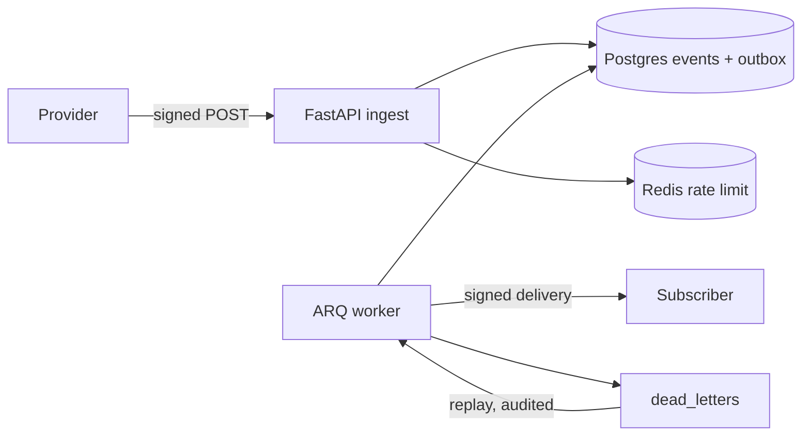

# HookRelay

[](https://github.com/supremeyuma/hookrelay/actions/workflows/ci.yml)

> A webhook gateway that accepts anything, loses nothing, duplicates nothing, and can
> replay a bad day of events without double-charging a customer.

**Status:** Phase 1 — skeleton, health, compose, and CI are in place.

**Stack:** Python 3.12 · FastAPI · Pydantic v2 · SQLAlchemy 2.0 · PostgreSQL 16 · Redis 7 ·
ARQ · Docker · GitHub Actions

## The problem

Providers retry. Networks fail. Subscribers go down for an hour. Most webhook endpoints
store a row and hope for the best, so a retry storm double-charges a customer and a
subscriber outage silently drops events.

## What it does

- Verifies HMAC signatures with a replay window and a request size cap.
- Dedupes on `(source, idempotency_key)` so retries create exactly one event.
- Fans out through a transactional outbox with exponential backoff and jitter.
- Classifies failures: 4xx is permanent, 5xx/429/network is retried.
- Dead-letters exhausted deliveries and replays them with an audit trail.
- Exposes traces, Prometheus metrics, and structured logs with request IDs.

## Architecture



## Run it

```bash
cp .env.example .env
# Put a generated Fernet key in SECRET_ENCRYPTION_KEY:
uv run python -c "from cryptography.fernet import Fernet; print(Fernet.generate_key().decode())"
# Set ADMIN_API_KEY to any 32+ character random string, then:
docker compose up --build
```

- API docs: <http://localhost:8000/docs>
- Liveness: <http://localhost:8000/healthz>
- Readiness (Postgres + Redis): <http://localhost:8000/readyz>

Apply migrations from the host:

```bash
uv run alembic upgrade head
```

## Tests

```bash
uv run pytest --cov=app
./scripts/verify.ps1   # format, lint, strict mypy, tests
```

## Design decisions

Phase 2+ links ADRs here. The short version: per-source idempotency keys, an outbox
instead of publish-on-write, and dead letters as a separate table rather than a status flag.

Operational choices already visible in the code:

- **Correlation IDs end to end.** Every request gets an `X-Request-ID` (incoming or
  generated), and every log line carries it.
- **Readiness is dependency-aware, liveness is not.** `/healthz` never touches Postgres or
  Redis, so a dependency blip cannot restart a healthy container.
- **Secrets are validated at boot.** A malformed Fernet key fails the process instead of
  failing the first webhook.
- **Errors never leak internals.** Unhandled exceptions return a request id and a generic
  message; the traceback stays in the logs.

## What I'd do next

- Per-destination transforms and circuit breakers (deferred; not needed for the reliability
  story).
- Multi-region ingest (deferred; single-region is enough for the measured numbers).

## License

MIT
