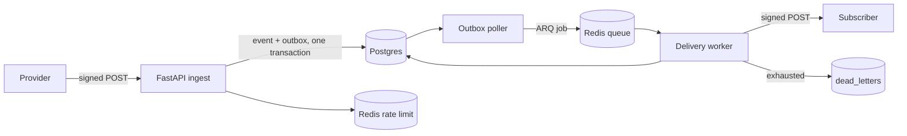

# HookRelay

[](https://github.com/supremeyuma/hookrelay/actions/workflows/ci.yml)

> A webhook gateway that accepts anything, loses nothing, duplicates nothing, and can
> replay a bad day of events without double-charging a customer.

**Status:** Phase 4 — scoped API keys, replay, and dead-letter recovery.

**Stack:** Python 3.12 · FastAPI · Pydantic v2 · SQLAlchemy 2.0 · PostgreSQL 16 · Redis 7 ·
ARQ · Docker · GitHub Actions

## The problem

Providers retry. Networks fail. Subscribers go down for an hour. Most webhook endpoints
store a row and hope for the best, so a retry storm double-charges a customer and a
subscriber outage silently drops events.

## What it does

- Verifies HMAC signatures with a replay window and a request size cap.
- Dedupes on `(source, idempotency_key)` so retries create exactly one event.
- Fans out through a transactional outbox with exponential backoff and jitter.
- Classifies failures: 4xx is permanent, 5xx/429/network is retried.
- Dead-letters exhausted deliveries and replays them with an audit trail.
- Exposes traces, Prometheus metrics, and structured logs with request IDs.

## Architecture



## Run it

```bash
cp .env.example .env
# Put a generated Fernet key in SECRET_ENCRYPTION_KEY:
uv run python -c "from cryptography.fernet import Fernet; print(Fernet.generate_key().decode())"
# Set ADMIN_API_KEY to any 32+ character random string, then:
docker compose up --build
```

- API docs: <http://localhost:8000/docs>
- Liveness: <http://localhost:8000/healthz>
- Readiness (Postgres + Redis): <http://localhost:8000/readyz>

Compose starts Postgres, Redis, the API, an ARQ delivery worker, and the outbox poller.
Apply migrations from the host:

```bash
uv run alembic upgrade head
```

## Tests

```bash
uv run pytest --cov=app
./scripts/verify.ps1   # format, lint, strict mypy, tests
uv run python scripts/smoke_ingest.py   # against a running compose stack
```

Delivery smoke check (starts a local sink, then drives the real poller and worker):

```bash
uv run uvicorn tests.fixtures.sink:app --port 9099
uv run python scripts/smoke_delivery.py
uv run python scripts/smoke_replay.py
```

## Send a signed event

Create a source. The signing secret is returned exactly once:

```bash
ADMIN_KEY=$(grep '^ADMIN_API_KEY=' .env | cut -d= -f2)
curl -s -X POST http://localhost:8000/admin/sources \
  -H "X-API-Key: $ADMIN_KEY" -H 'Content-Type: application/json' \
  -d '{"slug":"demo","name":"Demo provider"}'
```

Sign the exact raw body and send it with an idempotency key:

```bash
BODY='{"type":"charge.succeeded","amount":4200}'
SIG=$(uv run python scripts/sign.py "$SECRET" "$BODY")

curl -i -X POST http://localhost:8000/ingest/demo \
  -H "Content-Type: application/json" \
  -H "X-HookRelay-Signature: $SIG" \
  -H 'X-Idempotency-Key: evt_001' \
  -d "$BODY"
```

The first call returns `202 accepted`, an identical retry returns
`200 duplicate` with the same event id, and `GET /events/{id}` shows the stored event.
Signatures use `HMAC-SHA256(secret, f"{timestamp}.{raw_body}")` and are rejected outside the
configured tolerance window.

## Deliveries

Add a destination; its signing secret is returned once:

```bash
curl -s -X POST http://localhost:8000/admin/sources/demo/destinations \
  -H "X-API-Key: $ADMIN_KEY" -H 'Content-Type: application/json' \
  -d '{"url":"https://example.com/hooks/hookrelay"}'
```

Accepted events fan out after commit. Every attempt is signed with the destination secret
and carries `X-HookRelay-Event-Id`, `X-HookRelay-Delivery-Key`, and `X-HookRelay-Attempt`.
The delivery key is stable across retries and replays, so subscribers can dedupe.

- 2xx: success.
- 408/425/429/5xx/network/timeout: retried with exponential backoff (2s base, 300s cap,
  ±20% jitter); `Retry-After` is respected, capped at one hour.
- Other 4xx: permanent, no retry.
- After 8 attempts: the delivery is dead-lettered with a reason.
- `GET /events/{id}` lists every attempt, its status, and the response code.

## API keys, scopes, and replay

The bootstrap `ADMIN_API_KEY` from `.env` has every scope. Create narrower keys for
automation:

```bash
curl -s -X POST http://localhost:8000/admin/api-keys \
  -H "X-API-Key: $ADMIN_KEY" -H 'Content-Type: application/json' \
  -d '{"name":"ci-readonly","scopes":["events:read"]}'
```

The plaintext key is returned once; only its SHA-256 hash is stored. Scopes are
`admin:write`, `events:read`, and `replay:write`. Revoke with
`DELETE /admin/api-keys/{id}`.

Replay an event to all active destinations, or only the failed ones:

```bash
curl -s -X POST http://localhost:8000/events/$EVENT_ID/replay \
  -H "X-API-Key: $ADMIN_KEY" -H 'Content-Type: application/json' \
  -H 'Idempotency-Key: replay-2026-11-12-1' \
  -d '{"failed_only": true}'
```

Replays are appended as new attempts sharing the original delivery key, and every replay is
audited in `replays`. Reusing an `Idempotency-Key` returns the original result without
creating more deliveries. Dead letters replay with
`POST /admin/dead-letters/{id}/replay`, same header contract.

## Design decisions

- **Per-source idempotency keys** — [ADR-001](docs/adr/001-idempotency-scope.md).
- **Encrypted source secrets** — [ADR-002](docs/adr/002-secret-storage.md).
- **Transactional outbox instead of publish-on-write** —
  [ADR-003](docs/adr/003-outbox-pattern.md).
- **At-least-once delivery, not "exactly once."** Every attempt carries a stable delivery
  key; consumers dedupe. The outbox guarantees no accepted event is silently lost.
- **Retry classification is explicit.** Retrying a permanent 4xx would DDoS a broken
  subscriber, so only 408/425/429/5xx/network errors are retried.
- **Scoped, hashed API keys.** The bootstrap key is only for setup; automation gets the
  narrowest scope it needs, and stored keys are hashes with a display prefix.
- **Replays are append-only and idempotent.** A replay never mutates history; it adds
  attempts under the same delivery key, and the caller's idempotency key makes retries of
  the replay itself safe.

Operational choices already visible in the code:

- **Correlation IDs end to end.** Every request gets an `X-Request-ID` (incoming or
  generated), and every log line carries it.
- **Readiness is dependency-aware, liveness is not.** `/healthz` never touches Postgres or
  Redis, so a dependency blip cannot restart a healthy container.
- **Secrets are validated at boot.** A malformed Fernet key fails the process instead of
  failing the first webhook.
- **Errors never leak internals.** Unhandled exceptions return a request id and a generic
  message; the traceback stays in the logs.

## Security notes

Secrets handling, HMAC verification, scoped keys, SSRF, replay limits, and the known gaps
are documented in [`docs/security.md`](docs/security.md). Short version: secrets are
encrypted at rest and returned once, API keys are hashed and scoped, destinations are
SSRF-checked, and replay is append-only and idempotent.

## What I'd do next

- Per-destination transforms and circuit breakers (deferred; not needed for the reliability
  story).
- Multi-region ingest (deferred; single-region is enough for the measured numbers).

## License

MIT
