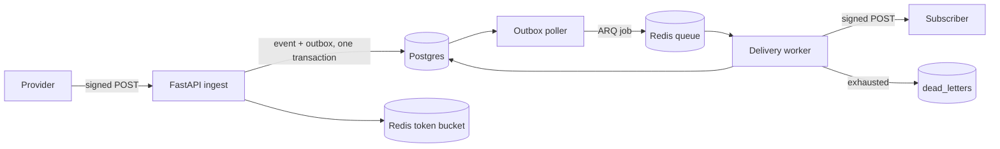

# Case Study: Building a Webhook Gateway That Refuses to Lie About Delivery

## The problem

A webhook endpoint is an unreliable boundary. Providers retry, sometimes with the same
event for hours. Subscribers go down. A naive endpoint does three bad things:

1. It writes the event and then publishes to a queue, so a crash between the two loses work.
2. It retries every failure, including permanent 4xx responses, turning one broken subscriber
   into a self-inflicted DDoS.
3. It claims "exactly once" because the happy-path test passed once.

HookRelay takes the unglamorous position: **accept exactly one event per idempotency key,
deliver at least once, and make replay an explicit audited operation.**

## Design

### Decision 1: per-source idempotency keys

The unique index is `(source_id, idempotency_key)`. A global key would let one provider's
`evt_1` suppress another provider's event. The insert is
`ON CONFLICT DO NOTHING RETURNING id`, so concurrency is resolved by Postgres, not by an
application lock. A hundred simultaneous identical requests produce one event and one outbox
row; the test asserts exactly that.

**Tradeoff:** callers must send a stable key. If they cannot, a body-hash fallback is the next
step, and the event row should record which strategy was used.

### Decision 2: transactional outbox, not publish-on-write

The event and its outbox row commit together. A separate poller claims unpublished rows with
`FOR UPDATE SKIP LOCKED`, expands them to deliveries, and enqueues ARQ jobs. If enqueue fails,
the delivery stays `pending` and the poller recovers it on the next tick; deterministic job
ids make re-enqueue safe.

**Tradeoff:** roughly one second of scheduling latency, and a second process to run. In
exchange, a crash between commit and publish cannot lose an accepted event.

### Decision 3: explicit retry classification

- 2xx: success.
- 408/425/429/5xx/network/timeout: retry with exponential backoff (2s base, 300s cap, ±20%
  jitter), honouring `Retry-After` up to one hour.
- Other 4xx: permanent. Do not retry.

Every attempt is a row with a stable `delivery_key`; consumers dedupe on it. Exhaustion writes
a dead letter. Replay appends new attempts under the same key and is itself idempotent via the
caller's `Idempotency-Key`.

**Tradeoff:** at-least-once, not exactly-once. The README says so, the delivery header makes
it actionable, and replay safety is tested with concurrent requests.

## Measured results

Reference host: i7-14650HX, 24 logical CPUs, 15.4 GiB to Docker, Windows 11 + WSL2.

| Metric | Value |
|---|---|
| Ingest | 419 req/s, p95 31.8 ms, 0.00% errors (10 VUs, 30s, 4 workers) |
| Health | 500 req/s, p95 1.1 ms |
| Ingest with fan-out | 278 req/s accepted, 3,042 deliveries drained in ~35s |
| Tests | 115 passing, 82% coverage |
| Trace | 16 spans across API and worker |

The first load attempt used an unbounded arrival-rate executor, spawned 1,000 VUs, and
collapsed the host at ~130 rps. That was a measurement bug, not an application result; the
fixed-VU run is the reproducible number. The full bottleneck analysis is in
[`failure-modes.md`](failure-modes.md).

## Bugs worth remembering

1. **The signature that signed different bytes.** A PowerShell smoke test passed the JSON body
   as a native argument; PowerShell 5.1 stripped embedded quotes, so the signature covered a
   different payload than the request. The fix was to stop shell-testing signed payloads and
   write `scripts/smoke_ingest.py` in Python. Lesson: test the transport, not a paraphrase of
   it.
2. **The outbox N+1.** Expansion originally did two queries per outbox row, which capped the
   poller around 150 events/s while ingest did 400. Replacing it with one join, one bulk
   destination lookup, and one bulk existing-delivery lookup drained an 8,800-row backlog to
   zero.
3. **The thundering herd.** A constant-arrival-rate k6 scenario reacted to early latency by
   allocating VUs up to its maximum, which made latency worse and allocated more VUs. Capping
   VUs made the same code look 5× faster. Lesson: load tools can be the bottleneck.

## What I would do next

- Add a per-destination circuit breaker and a DLQ-rate alert.
- Move secrets to envelope encryption with a KMS and key ids per row.
- Add `expires_at` and ownership to API keys.
- Partition `events`/`deliveries` by month and add PgBouncer before chasing 10× traffic.
- Add a Kafka/log-based pipeline only if ingest needs to exceed what one Postgres primary can
  absorb; the outbox contract is already compatible with a CDC publisher.
